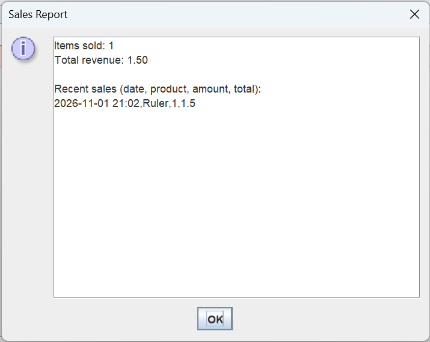

# MiniShopManager

A desktop inventory and sales app for a small shop, written in Java with Swing. I built it step by step as a learning project.

## Screenshots

## Features

- Product table with name, price and quantity
- Add, edit, sell and delete products
- Live search by product name
- Low-stock warning: products with fewer than 5 items are highlighted in red
- Sales report with total items sold, total revenue and the most recent sales (with date and time)
- One-click backup of all data files
- Input checks (empty names, negative numbers, not enough stock)
- Data is saved in plain text files, so it stays after closing the app

## Built with

- Java 21
- Swing (JFrame, JTable, JOptionPane)
- Text files for storage

## Files

- `ShopWindow.java`: the main window (run this class)
- `Product.java`: the product class
- `Main.java`: file saving and loading helpers

## What I plan to add next

- Barcode support
- Returns
- Password protection
